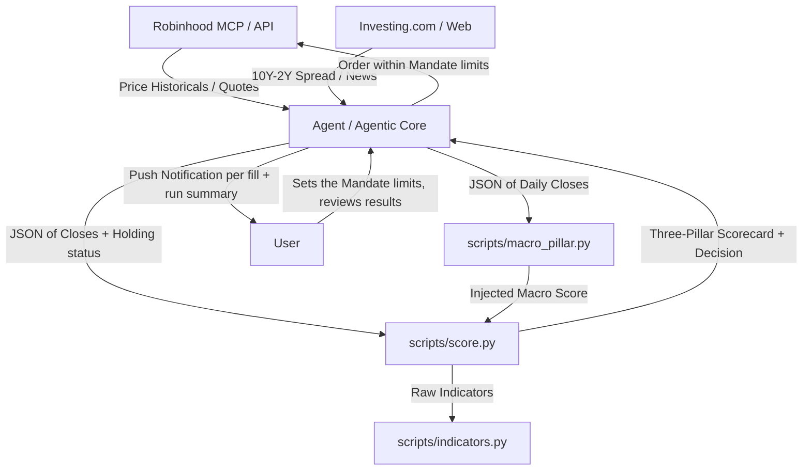

# Agentic Trading Desk

Personal trading desk for technical analysis and short-term portfolio management on stocks and ETFs. The system combines the automation and query capabilities of an Artificial Intelligence agent (via Robinhood MCP protocol) with local deterministic mathematical calculation engines in Python.

The ruling principle is: **the AI fetches data and interacts with the user; the scripts perform the deterministic calculations; the user decides and approves execution.**

---

## 🚀 Project Architecture

The project is designed to operate locally and modularly. All technical indicator computations are delegated to Python 3 scripts that only use the Python standard library (`stdlib`), ensuring speed and zero network dependencies during execution.



### File Structure
*   **[SKILL.md](SKILL.md)**: Operations manual and specific guardrails guiding the AI agent's actions.
*   **[scripts/indicators.py](scripts/indicators.py)**: Mathematical engine to calculate technical indicators without visual estimations.
*   **[scripts/macro_pillar.py](scripts/macro_pillar.py)**: Macro regime detector and cross-asset sentiment scorer.
*   **[scripts/score.py](scripts/score.py)**: Evaluator of the three-pillar framework and exit/entry decision engine.
*   **[scripts/prepare_inputs.py](scripts/prepare_inputs.py)**: Turns raw Robinhood MCP output into script inputs — drops interpolated bars and appends today's close (Step 0) from the broker's own dates.
*   **[scripts/session-setup.sh](scripts/session-setup.sh)**: Installs `jq` and proves the order guard is alive (15 probes per guard copy, plus a sync check of the user-level copy).
*   **[hooks/mandate-order-guard.sh](hooks/mandate-order-guard.sh)** + **[.claude/settings.json](.claude/settings.json)**: `PreToolUse` guard that enforces the Mandate's order rules outside the model.
*   **[gemini-spark/](gemini-spark/)**: Sanitized version of the skill and scripts compatible with Gemini Spark security policies. The scripts are identical copies of `scripts/` and the order-type rules match the main skill; the intentional difference is that the Spark version allows **zero discretion** (only `score.py` decisions are executable) and does not ship the order-guard hook.

---

## 📈 The Three-Pillar Framework

Each analyzed asset is scored in three independent categories with scores from **-2 to +2** (for a consolidated total range of **-6 to +6**):

### 1. Trend
Determined in [scripts/score.py](scripts/score.py#L30) using:
*   Price position relative to the **EMA 20**.
*   Structural crossovers between exponential moving averages: **EMA 20 > EMA 50** and **EMA 50 > EMA 200**.
*   Slope direction of the **EMA 200** (measured relative to 5 bars ago).

### 2. Momentum
Determined in [scripts/score.py](scripts/score.py#L58) combining:
*   **RSI-14** using **Wilder's** smoothing (neutral zone from 45 to 55).
*   Sign of the **MACD (12, 26, 9)** histogram.
*   **TRIX-15** (triple EMA rate of change) compared against its EMA-9 signal line.

**Bollinger Bands** (20/2, population σ) are also computed and used as a supporting exhaustion signal (`%B ≥ 1` flags price at/above the upper band) but do not feed into the numeric momentum score.

### 3. Macro-Sentiment (Macro Environment)
Calculated by the [scripts/macro_pillar.py](scripts/macro_pillar.py) cross-asset analysis script, which weights the following components:
*   **Market Concentration**: RSP/SPY (equal-weight vs. cap-weight S&P 500).
*   **Yield Curve**: 10Y-2Y treasury yield spread (injected from Investing.com).
*   **Corporate Credit**: HYG/LQD ratio (high-yield vs. investment-grade).
*   **Size Factor**: IWM/SPY ratio (small caps vs. large caps).
*   **Asset Preference**: SPY/TLT ratio (equities vs. bonds).
*   **Sector Rotation**: XLY/XLP ratio (cyclical vs. defensive sectors).
*   **Inflationary Correlation**: Rolling SPY-TLT correlation.

---

## 🛠️ Script Usage

The scripts are run via the command line consuming data in JSON format. Run any of them with no arguments to execute its self-test.

### 0. Preparing Inputs from Robinhood MCP Output
Save the `get_equity_historicals` and `get_equity_quotes` responses to files, then:
```bash
python3 scripts/prepare_inputs.py --historicals hist1.json hist2.json --quotes quotes.json --out work/
```
It drops bars flagged `interpolated: true` (synthetic fill — e.g. the whole span before a recent IPO), appends today's `last_trade_price` when the session has traded (marked *provisional* during regular hours, *final* after 16:00 ET), excludes stale symbols, and writes `work/ticker_<SYM>.json`, `work/macro_input.json` and a per-symbol report in `work/closes.json`.

### 1. Raw Indicators Computation
To obtain the detailed breakdown of all calculated indicators for an asset:
```bash
python3 scripts/indicators.py input_ticker.json
```
*Expected format for `input_ticker.json`:*
```json
{
  "close": [100.5, 101.2, 102.0, 101.8, 103.1, ...]
}
```

### 2. Macro-Sentiment Scoring
To calculate the regime and macro pillar of the session:
```bash
python3 scripts/macro_pillar.py macro_input.json --json
```
*Expected format for `macro_input.json`:*
```json
{
  "as_of": "2026-07-02",
  "yield_spread": -0.15,
  "series": {
    "SPY": [450.1, 452.3, ...],
    "RSP": [152.0, 151.8, ...],
    "IWM": [198.5, ...],
    "HYG": [...],
    "LQD": [...],
    "TLT": [...],
    "XLY": [...],
    "XLP": [...]
  }
}
```

### 3. Ticker Scoring and Decision
To obtain the complete three-pillar scorecard and action suggestion for the Agentic account:
```bash
python3 scripts/score.py ticker_input.json        # human-readable table
python3 scripts/score.py ticker_input.json --json  # machine-readable output
python3 scripts/score.py                           # self-test with synthetic data
python3 scripts/score.py work/ticker_AAPL.json --macro-score 1 --holding true  # override input fields
```
*Expected format for `ticker_input.json`:*
```json
{
  "symbol": "AAPL",
  "close": [220.5, 222.1, 221.8, ...],
  "macro_score": 1,
  "holding": true
}
```

The output includes the three-pillar scorecard, active flags (exhaustion / bearish / rebound / death-cross), and one of the following decisions:

| Decision | Context |
|---|---|
| `EXIT / TRIM` | Holding — bullish momentum exhausted |
| `EXIT` | Holding — bearish momentum relentless |
| `RE-ENTRY (new cycle)` | Flat — rebound with healthy EMA structure |
| `TACTICAL REBOUND (counter-trend)` | Flat — rebound inside a death-cross (reduced size, conditional exit on close) |
| `HOLD (ride the cycle)` | Holding — trend and momentum positive |
| `HOLD (under review)` | Holding — weak signals, no full exit trigger yet |
| `WAIT (do not chase)` | Flat — healthy trend but no fresh entry trigger |
| `STAY OUT / AVOID` | Flat — relentless bearish, no rebound |
| `HOLD / OBSERVE` or `OBSERVE` | Mixed signals — no action, watch next close |

Before selecting a decision, the script detects **flags** — specific indicator patterns that signal exhaustion (e.g., RSI turning from overbought, MACD histogram shrinking), bearish persistence, or rebound triggers. The decision cascade prioritizes exit triggers for holders and entry triggers for flat positions. When `macro_score ≤ -1`, the framing is adjusted (tighter targets, reduced size) but the numeric pillar scores remain unchanged.

---

## 🤖 Claude Code Integration

To use this project as a **Skill** with Claude Code for automated trading analysis:

### 1. Add the Skill
Place the skill in your Claude Code skills directory (`~/.claude/skills/`), or upload it as a skill on claude.ai:
```bash
# Clone or copy this repository to your skills folder
cp -r /path/to/agentic-trading-desk ~/.claude/skills/agentic-trading-desk
```
Then register the order guard at user level — see *Enforcing the Mandate* below. A skill directory is not a project directory, so the skill's own `.claude/settings.json` is not read.

Or reference it directly from this repository.

### 2. Agent Operation
Once loaded, Claude Code will:
* Automatically use this skill when you ask to analyze tickers, review positions, or make trading decisions
* Fetch data via Robinhood MCP protocol
* Call the Python scripts (`scripts/indicators.py`, `scripts/score.py`, `scripts/macro_pillar.py`) for deterministic calculations
* Present the three-pillar scorecard with actionable decisions
* **Execute autonomously in the Agentic account under the Autonomous Execution Mandate** — market orders during regular hours only, no orders at all outside them, never limit or stop orders, within hard caps on order size, new positions per session, and cash reserve. See the Mandate section in [SKILL.md](SKILL.md) for the exact limits, and set them to your own risk tolerance before enabling.

### 3. Example Workflow
```
You: "Analyze AAPL for a potential entry"

1. Data Fetching (Robinhood MCP)
   → Fetches AAPL daily historicals (~290 bars for EMA 200)
   → Fetches live quote (current price / last close)
   → Checks if there is an open position → sets holding = true/false

2. Macro Pillar (once per session, shared across all tickers)
   → Fetches historicals for 8 ETFs: SPY, RSP, IWM, HYG, LQD, TLT, XLY, XLP
   → Retrieves 10Y-2Y yield spread from Investing.com
   → Runs: python3 scripts/macro_pillar.py → macro_score (-2 to +2)

3. Ticker Scoring
   → Assembles JSON with {symbol, close, macro_score, holding}
   → Runs: python3 scripts/score.py → three-pillar scorecard + decision
     (score.py calls indicators.py internally for all calculations)

4. Qualitative Context (reinforcement, does not alter scores)
   → News and macro context from Investing.com
   → Analyst consensus and price targets from Google Finance

5. Execution and Reporting
   → Returns: Scorecard, flags, and action (RE-ENTRY, HOLD, EXIT, etc.)
   → If the action is executable and inside the Mandate limits: review_*_order,
     then place_*_order within the order-type rule, then a push notification
   → If it falls outside the limits: no trade, and the reason is reported
```

The agent operates under the principle: **AI fetches data; scripts perform deterministic calculations; the framework decides and the agent executes within limits you set in advance.** Discretionary trades are allowed in the main skill, but each one must carry its written reasoning in the session report (what was seen, why it justified acting, what would prove it wrong). The Gemini Spark version allows zero discretion.

---

## 📰 External Qualitative Context (Reinforcement)

To complement the purely technical nature of the deterministic scripts, the AI agent integrates a real-time **qualitative reinforcement analysis** before presenting the final recommendation:

1.  **News and Macro**: Dynamically retrieved from **Investing.com** (validated source to avoid prompt injection risks).
2.  **Analyst Consensus and Reports**: Queries **Google Finance Beta** (`https://www.google.com/finance/beta/quote/<TICKER>:<EXCHANGE>?tab=analysis`) to extract:
    *   Overall consensus (*Buy/Hold/Sell*).
    *   12-month price targets (average, maximum, minimum) contrasted against the current price of the ticker.
    *   Recent earnings results (actual vs. estimated).
    *   Recent analyst rating changes (< 2 weeks).

*Note: This information is presented to the user alongside the three-pillar scorecard as interpretive context; **it does not directly alter** the mathematical score returned by the scripts, ensuring that quantitative triggers and risk management remain 100% deterministic.*

---

## 🛡️ Guardrails and Operation (Non-Negotiable)

1.  **Special Position Protection**: Certain positions can be designated as *protected* (e.g., restricted stock grants). Protected tickers are never evaluated for selling or trimming in exit suggestions.
2.  **Account Segregation**: The tradable account is identified by the broker's own agent-tradable flag from `get_accounts` — never by nickname, never by a hardcoded account number. Orders against any other account are rejected by the broker.
    *   **Agentic**: Oriented toward fast returns and capital rotation via tactical trades and defined cycles. The only account the Mandate covers.
    *   **Individual** (Margin Account): Core passive long-term investing. Analysis only.
3.  **Buying Power**: Always taken from `get_portfolio.buying_power` rather than derived. Account type matters and can change: a cash account settles T+1, while a limited-margin account can trade unsettled proceeds immediately.
4.  **Mandatory Simulation**: Every order passes through `review_*_order` with the exact parameters before `place_*_order`. The trade is aborted and reported if the review returns any `order_checks` alert, or if its quote is more than 1% away from the price the analysis used (a dollar-sized market order's review has no fill price or share count to compare). An order that comes back `customer_approval_required` is reported as pending approval, not executed.
5.  **Mandate Limits Are Hard**: A limit exceeded is not a prompt to ask for permission — it is a stop. The agent does not trade and reports why. Circuit breakers halt new buys if the account is down more than 4% on the day, or if the data does not reconcile.
6.  **No Backtest**: This framework has not been backtested. A trigger firing does not make it correct. Set the Mandate limits to a size where being wrong is survivable.

---

## 🔒 Enforcing the Mandate (`hooks/mandate-order-guard.sh`)

The Mandate's order rules — **`market` orders during regular hours only, no orders outside them, never a limit or stop order, buys sized in dollars and capped** — are prose addressed to the model. Nothing in the prose enforces them, and in practice they have been broken. `hooks/mandate-order-guard.sh` is a `PreToolUse` hook that runs in the Claude Code harness, outside the model, and denies the `place_equity_order` call before it leaves.

**Why no orders outside regular hours.** The agentic account holds fractional positions and sizes entries at ~3% of the account, below one share of nearly everything it trades. Robinhood accepts fractional and dollar-based orders **only in `regular_hours`** (verified 2026-10-19 with `review_equity_order`: a fractional limit with `market_hours=extended_hours` is rejected with *"fractional and dollar-based orders are only allowed in regular_hours"*; without `market_hours` the same order is accepted — as a `regular_hours` order that queues for the next open). An earlier verification that "fractional limits work after hours" had tested the second case. So after hours there is nothing the desk can trade that would actually fill after hours.

The guard reads the session clock in America/New_York (RTH = Mon–Fri 09:30–15:58 ET; holidays are not known to it — `gfd` is the backstop).

| Order | Guard |
|---|---|
| RTH: `market` buy + `dollar_amount` ≤ $1,200, `gfd` | ALLOW |
| RTH: `market` sell, `dollar_amount` or `quantity`, `gfd` | ALLOW |
| RTH: `market` buy by `quantity` | DENY — no price in the payload, cap uncheckable |
| `limit`, `stop_market`, `stop_limit` | DENY |
| any order outside RTH, or on a weekend | DENY |
| `market_hours` other than `regular_hours` | DENY |
| `time_in_force` missing or not `gfd` | DENY |
| `side` not `buy`/`sell`; non-numeric or ≤ 0 size; both or neither of `dollar_amount`/`quantity`; `limit_price` on a market order | DENY |
| buy with notional > $1,200 | DENY |
| unparseable payload, unreadable clock, or `jq` not installed | DENY — the guard fails closed |
| guard script missing or crashing | DENY — the registered command exits 2 (blocking) |

Sells are not notional-capped: Robinhood has no short selling, so a sell is bounded by the shares held, and a cap would block exiting a position that has grown past $1,200.

**Fail-closed, end to end.** Every rule is implemented with `jq`; without it the script would exit 0 with no output, which the hook runner reads as ALLOW, so the guard checks for `jq` first and denies without it (verified 2026-08-26: an earlier revision let a `stop_market` through that way). A hook command that fails with a non-zero exit other than 2 is a *non-blocking* error — also an ALLOW — so the registered command is wrapped: `bash guard.sh || { echo '…' >&2; exit 2; }`.

### Where the hook runs — and where it does not

Hooks are a Claude Code feature. They run only where a `settings.json` registers them:

| Client | Guard | How |
|---|---|---|
| Claude Code on your machine — any project, skill mode included | ✅ | **User level**: `~/.claude/settings.json` + a copy at `~/.claude/hooks/mandate-order-guard.sh` (recommended; below) |
| Claude Code with this repo as the project directory (local or cloud) | ✅ | **Project level**: [.claude/settings.json](.claude/settings.json), also wires `SessionStart` → `session-setup.sh` |
| claude.ai app, Cowork, other agent runtimes, a scheduled run that opens another repo | ❌ | No hooks exist there. The `SKILL.md` preflight table is the whole safety margin; the only broker-side control is Robinhood's trade-approval setting (`human_must_approve_trades`), which only you can change in the app |

**User-level install** (keep the copy outside removable media, so the path always resolves):
```bash
install -m 755 hooks/mandate-order-guard.sh ~/.claude/hooks/mandate-order-guard.sh
```
```json
{
  "hooks": {
    "PreToolUse": [
      {
        "matcher": "mcp__.*Robinhood__place_equity_order",
        "hooks": [
          { "type": "command", "command": "bash \"$HOME\"/.claude/hooks/mandate-order-guard.sh || { echo 'MANDATE BLOCK: the order guard failed to run (missing or crashed); failing closed.' >&2; exit 2; }", "timeout": 10 }
        ]
      }
    ]
  }
}
```
The matcher is a regex on purpose: the MCP server prefix differs between installs (`mcp__Robinhood__…` vs `mcp__claude_ai_Robinhood__…` for the claude.ai connector), and a literal matcher for the wrong prefix never fires. **Verified live 2026-10-19**: a prohibited `place_equity_order` (a `limit`) through the claude.ai connector was denied by the hook before reaching Robinhood.

**Keep the copies in sync.** A user-level copy is a fork. That is how a guard from 2026-08-26 — which still allowed limit orders, after-hours orders and quantity-sized market buys, and did not fail closed — stayed registered into October. `session-setup.sh` now compares `~/.claude/hooks/mandate-order-guard.sh` byte-for-byte with the skill's copy and refuses to verify when they differ; re-run the `install` line above after every guard change. If you use the skill uploaded to claude.ai, re-upload it after changes too: that synced copy does not update from this repo.

**`session-setup.sh`** installs `jq` (root or passwordless `sudo`; never prompts), checks the user-level copy is in sync, and runs **15 probes against every guard copy** — 12 prohibited orders that must be denied and 3 permitted ones that must pass (a guard that denies everything is as broken as one that allows everything). It prints `order guard verified` and exits 0 only if every probe behaves; otherwise `ORDER GUARD NOT VERIFIED` and exit 1. A `SessionStart` hook cannot block the session — its output lands in the session context, and `SKILL.md` forbids executing orders unless that line says verified. In skill mode `SKILL.md` runs it by hand.

*   **Cloud runs** (claude.ai/code): the environment's **network access must be `Trusted`** or higher, or `apt-get` cannot reach the Ubuntu archives and `session-setup.sh` fails by design. Hooks load only for the repository the session opens — confirm a scheduled run opens this one. See https://code.claude.com/docs/en/claude-code-on-the-web
